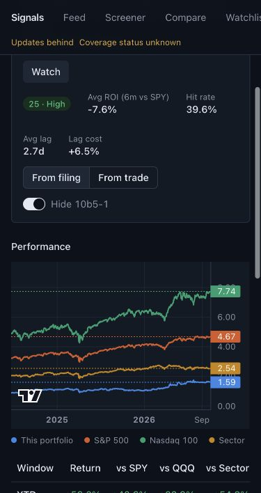

# Signals v2 P0 — in progress

Date: 2026-10-03 morning ET. Branch: `feat/sec-dashboard`.

The completeness report and empty-state explanations are implemented and locally deployed. Insider charts now prepare their own price/analytics inputs independently of the full import. Buffett's real chart is populated on both bases. Two measured fund-import failures have been fixed; request 3 resumes its remaining historical work. P0 remains in progress; P1–P4 have not started. Claude's review and the P0.6 merge/tag gate remain pending.

## Current implementation

| Task | Implementation and verification | Remaining acceptance |
|---|---|---|
| P0.1 | Existing catch-up/index recovery retained; all 42 insider datasets and reference complete | Finish request 3, fresh SEC spot-check and five user eye checks, continuous business-hour latency, complete real profiles and security/final review |
| P0.2 | `7eb1ea2`, `83cff24`: read-only completeness endpoint, exact SEC index membership, daily/supported-era counts, both 126-session return bases, price and fund coverage, weekly/final check, coalesced gap recovery, three-attempt diagnostics, header and Health report | Initial worker baseline check follows prices/full analytics; current unknown baselines are visible |
| P0.3 | `c5a35b0`, `a76c68a`, `abc5383`: honest empty states, accessible rating descriptions, timezone-aware retries and scoped worker price/analytics requests with per-profile progress, coalescing, checkpoint priority and automatic query refresh; real populated Buffett chart verified | Complete population coverage remains pending |
| P0.4 | `3aca5a8`: reuse this batch's normalized position totals rather than rescanning historical partitions per filing; output equivalence and repeatability verified | Full analytics duration/RSS and 100-request endpoint p95 measurements after backfill |
| P0.5 | `c48675e`: live-only historical/profile browser acceptance and read-only coverage summary | Four initial live criteria failed while data was incomplete; rerun after backfill |
| P0.6 | Phase report updated | Claude review, fix findings, explicit user approval before merge/tag |

## Measured loading blockage

At 21:57 ET on October 2, the 13F feed-summary SELECT had run for about seven hours. Each accession ran two correlated aggregates against `fund_positions` without a period condition, scanning historical partitions. A live poll was waiting on its fund-manager transaction lock for more than four hours. Prices were pending behind `backfill_funds`, explaining the persistent 0% performance state.

The regression plan read 38 historical partition scans before the fix and zero afterward. The insert now uses `RETURNING` and aggregates normalized new positions into a small temporary table. Recorded 2022/2025 filings produce matching legacy feed summaries, including notices, amendments, old periods and duplicate positions; repeat loads remain idempotent.

Worker recovery at 21:57 ET retained completed checkpoints. Two old connections continued running after their container stopped; their backend identities and blocking relationships were verified before terminating only those stopped-worker sessions. The stalled 2016Q3 dataset completed at 21:59 ET. Subsequent checkpoints advanced through 2019Q4 at 22:13 ET and reached 29 fund datasets by 23:36 ET. This measures backfill progress; final analytics budgets remain pending.

## Scoped chart loading and real measurements

`abc5383` adds `refresh_insider_performance`: the page requests the owner's inputs, polls one compact job record, and invalidates its header/curve/decisions after completion. Active requests deduplicate per owner, including concurrent mounts and basis changes. Rejected/failed/completed-empty jobs never enqueue loops. A completed local result remains usable when global coverage is delayed or fails.

The worker retains singleton/provider and maintenance guards. Requests claim ahead of historical work; durable dataset/gap checkpoints yield and resume without losing progress or marking deferrals as failures. Startup catch-up defers to these requests. Price scope contains dated symbols for the owner's actual trades and comparison benchmarks. Analytics preserves unrelated decision IDs and refreshes affected joint owners atomically. Global price/backfill completion state is unchanged by this subset.

Real request **431**, owner **315090**, finished at **09:12:10 ET** after being requested at **09:10:50 ET**: 41 symbols checked, 39 returned data, **84,553 price rows**, **56 decisions**, **448 return rows**, **12 profile-stat rows**. Analytics took **7.34 seconds**. LBTY and LLYVA.K have no provider data. The filed curve has **2,700 points** (2016-01-07–2026-10-02); executed has **2,703** (2016-01-04–2026-10-02). Header reports **53 completed decisions**. Real Chromium acceptance passed curves/windows on both bases; the visible local browser shows the populated chart.

One cold filed request took **604.96 ms**, executed **509.15 ms**. Across 100 sequential warm filed-chart requests including JSON decoding: median **69.26 ms**, p95 **244.81 ms**, maximum **1032.42 ms**. These measurements cover one cached chart; they do not establish the full endpoint/nightly acceptance budgets.

## Valid SEC wrapper archive recovery

Request 3 stopped after 38 fund datasets because the next valid archived `01jun2025-31aug2025_form13f.zip` puts all four required TSVs inside `01JUN2025-31AUG2025_form13f/`. The previous dataset used root-level files. `5e4f85f` resolves exact unique TSV basenames from ZIP members at either location; conflicting members fail before loading/checkpoint writes. No archive was deleted or modified. Seven regressions cover ordinary/nested wrappers, ignored metadata, idempotence, ambiguity and preserved failed-request checkpoints. The fixed worker was activated and request 3 resumed at **09:24:27 ET**, retaining all completed units.

At **09:30:41 ET**, request 3 was running without an error and had advanced to **42 completed fund datasets**. The running loader's SHA256 matches the committed source. This confirms live recovery past the wrapped archive; later fund/stake/mapping and global price/analytics work remain pending.

## Completeness review fixes

Counts alone can hide a missing expected filing when an unrelated parsed filing arrives after the check. `0002_completeness_members` adds an independent expected-membership table with accession, form and filing date, streamed through COPY in the same transaction as the lightweight baseline. API counts require an exact match; legacy baselines remain unknown. Tests verify late unindexed filings, wrong form/date, target-quarter isolation, 1,505 absent expected filings and transaction rollback. Raw filings and archives are retained.

Repeated SEC index rows and legacy retry entries now spend one attempt per accession per scan, while preserving raw-row offsets. Incorrect parsed metadata is fetched and repaired against the index; conflicting submission metadata fails visibly and retains the raw body. Terminal unavailable accessions remain visible without a fourth fetch.

## Final checks and local activation

- Backend: **816 tests passed in 48.30 seconds**; Ruff format/check and Pyright exit 0. Generated OpenAPI is updated and contract tests pass. Single migration head: `0002_completeness_members`.
- Frontend: **177 tests passed**, build/lint exit 0. Existing Vite bundle and TanStack compiler warnings remain.
- Mock Chromium: **12 passed**, four live acceptance tests intentionally skipped without `E2E_BASE_URL`.
- Rebuilt API, migrate, worker and web. Applied the additive migration before activating the API/worker. Request 3 resumes from its saved checkpoints.
- Real mature-insider Chromium acceptance: **1 passed** on both bases. Local Buffett chart/window values and populated decisions verified; screenshot above. The prior Lennar 12-month net showed $53.88M.
- Live coverage summary is recorded in plan 08's RESULTS.md. Its baseline/price/return/fund gaps remain acceptance evidence, not waived criteria.

## Initial recovery fix

Commit: `d6443ca` (`fix: preserve SEC index gaps and Eastern dates`).

The existing gap filler swallowed a 404 for a quarterly index or a current-quarter daily index and then marked the quarter complete. Daily reconciliation also treated a missing business-day index as a successful empty day and could advance `reconcile_last_day` beyond it.

- Missing quarterly and SEC-business-day indexes now raise through the normal run/request diagnostics, preserving their checkpoints for retry. Actual SEC holidays are skipped through the SEC calendar.
- Current-quarter selection uses the Eastern date instead of Docker's UTC date. At 21:00 ET on September 30, the worker now uses Q3 daily indexes even though UTC is already October 1.
- Fund/stake gap fills end yesterday in Eastern time, matching insider gap fills and avoiding today's unpublished index.
- Six regression cases were observed failing before the changes. They cover quarterly and daily 404 retry, retained reconciliation checkpoints and health errors, UTC quarter rollover, and fund date limits across daylight and standard time. Existing current-quarter tests now use a fixed date.

## Initial recovery checks (September 30)

- Baseline: backend 739 passed; frontend 119 passed, build and lint exit 0.
- Final verification after fixing test dates: backend 745 passed in 51.34 s; Ruff format/check and Pyright exit 0. Frontend sources and API schemas are unchanged.
- OpenAPI regeneration: no drift. Alembic: one head, `0001_initial`.
- Existing nonfatal frontend warnings: localStorage runtime warnings, large Vite bundle, and TanStack Table's React Compiler compatibility warning.
- These checks use recorded/mocked HTTP and isolated test databases. They do not prove live historical completeness, live latency or analytics performance.

## Decisions

The exhaustive rulings are recorded in `docs/superpowers/ledgers/v2-p0.md`:

1. Fail visibly on unavailable quarterly/business-day indexes rather than treating them as empty. Cost if wrong: a permanently unavailable index requires an explicit recovery decision and will block completion.
2. Use Eastern SEC dates and exclude today from fund/stake gap fills. Cost if wrong: today's filings rely on live polling until the next reconciliation.

## Initial local activation (September 30)

Worker-only build/restart exited 0 at 22:02 ET. Request 3 resumed with reference complete and **22 completed insider quarters** retained. Hashes of all three changed production files inside the running worker match the committed source. At 22:08 ET, health reports an incomplete backfill/deferred catch-up, no SEC pause and no parse errors. Funds, prices and full analytics are still pending. The API and web containers were unchanged.

## Plan review findings for the architect

These are issues in the new plans to resolve when their tasks are reached; the binding specs have not been edited.

- **Resolved — completeness scope.** P0.2 honors v1 §2: ownership/13F from the configured backfill start, electronic Form 144 from 2023-04-13 and structured 13D/G from 2024-12-18. Earlier unsupported periods and partial opening quarters are explicit and regression tested.
- **Important — score training cutoff.** `P2-edge-backtest.md:116` restricts training by filing date alone. A December 2020 filing can have its 126-day outcome in 2021; using that outcome to fit the model used for January 2021 signals violates the point-in-time constraint. P2.3 needs an outcome-availability cutoff and a regression proving that adding outcomes first known after that cutoff cannot alter the out-of-sample model. Historical actor-relative features also need filing-time windows.
- **Dependency — Congress edge.** P3 is allowed to run alongside P2, but `P3-congress.md:200` consumes the edge implementation from P2.1. P3.1–P3.5 can proceed independently; P3.6 must wait for that interface and schema to be integrated.

## Remaining acceptance work

- Allow request 3 to finish fund/stake history, mapping, prices, full analytics and the final completeness check without resetting its checkpoints.
- Run the fresh SEC spot-check at a suitable checkpoint through the worker singleton lock, then obtain the user's five visual checks.
- Measure latency during 09:00–20:00 ET after a continuous worker hour; October 1 and October 2 observations did not meet the target and are preserved in plan 08's RESULTS.md.
- Run full real-data profiles/browser smoke, coverage queries, security sweep and endpoint/analytics timings. Do not infer their results from this test run.
- Finish P0.1/P0.4/P0.5 live evidence, then request Claude's review and the explicit P0.6 merge gate.
